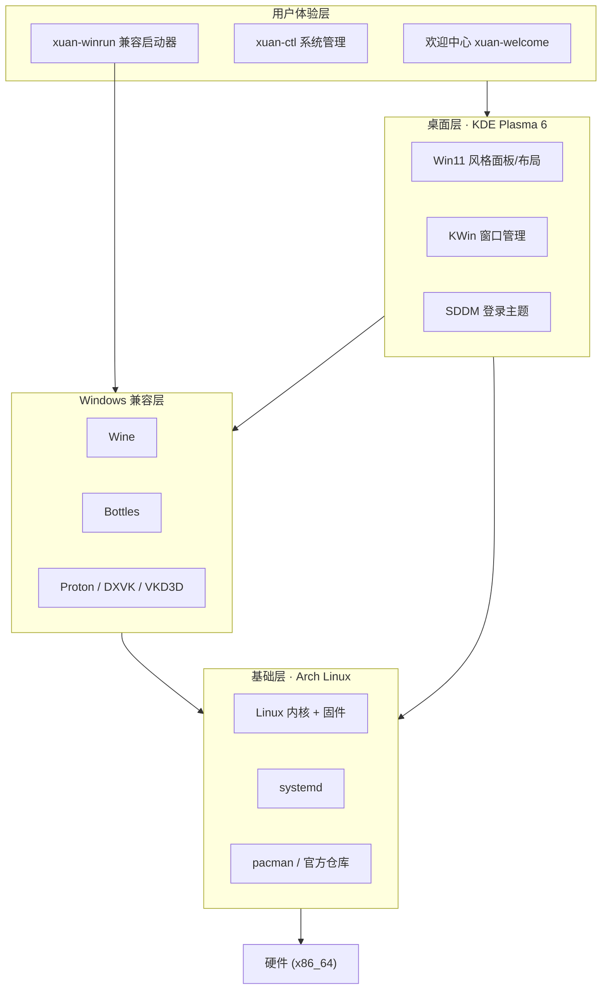

# xuan OS

> The freedom of Linux, the ease of Windows.

xuan OS 是一个面向桌面的开源操作系统发行版，目标是把 Linux 的稳定、安全、
可定制，与 Windows 用户熟悉的图形体验、软件兼容能力结合在同一个系统里。

本仓库是 xuan OS 的完整构建源：包含 ISO 构建配置、Windows 兼容层集成、
桌面品牌定制、原创系统工具与图形安装器配置，全部可自由审计与再构建。

---

## 为什么是这样一条技术路线

操作系统内核是工业级工程：Linux 内核由全球数千名开发者维护了三十余年，
代码量以千万行计；而 Windows 是专有闭源软件，其源码不允许被复制或二次分发。
因此"从零写一个新内核"或"直接基于 Windows 代码改造"在两天内既不现实，
也不合法。

xuan OS 采用开源世界验证过的正道——这与 SteamOS、Ubuntu、Pop!_OS、
统信 UOS 的做法一致，**不是抄袭，而是在开源许可证之上的合法集成与原创增值**：

- 以 **Arch Linux 滚动内核**为底座，内核与驱动始终保持最新；
- 以 **KDE Plasma 6** 构建 Windows 11 风格的桌面交互；
- 以 **Wine / Bottles / Proton** 让 Windows 的 `.exe`、`.msi` 直接运行；
- 以本仓库的原创工具（`xuan-ctl`、`xuan-winrun`、欢迎中心）提供统一体验。

---

## 核心特性

| 维度 | xuan OS 的做法 |
| --- | --- |
| 内核 | 滚动更新的 Linux 内核，安全补丁与硬件支持第一时间到达 |
| 桌面 | Win11 风格居中任务栏、开始菜单、圆角窗口、强调色与模糊效果 |
| Windows 兼容 | 双击 `.exe` 即经 Wine 运行；Bottles 管理多环境；Proton 支持游戏 |
| 软件管理 | pacman 官方仓库 + Flatpak/Flathub，签名校验，可复现构建 |
| 驱动管理 | `xuan-drivers` 检测 GPU/网卡/声卡，一键安装开源或专有驱动 |
| 系统治理 | `xuan-ctl` 覆盖更新、服务、btrfs 快照、电源模式与健康体检 |
| 工程化 | GitHub Actions 自动测试并构建 nightly ISO，全流程可审计 |
| 安全 | 默认启用 ufw 防火墙、最小化权限、`arch-audit` 漏洞跟踪 |
| 本地化 | 内置 Fcitx5 中文输入法、CJK 字体与中文欢迎中心 |
| 安装 | Calamares 图形安装器，支持 LUKS 加密、UEFI / BIOS 双引导 |

---

## 系统架构



---

## 快速构建

需要一台已更新的 Arch Linux 构建主机（或等价容器），并安装 `archiso`：

```bash
sudo pacman -S --needed archiso rsync librsvg grub fontconfig
git clone https://github.com/xuanos/xuanos.git
cd xuanos
./build.sh
```

产物位于 `build/out/`，包含可启动 ISO 与 `SHA256SUMS.txt`。
用 Ventoy / Rufus（DD 模式）写入 U 盘即可进入 Live 试用环境，
双击桌面"安装 xuan OS"或在欢迎中心启动安装器。

清理构建中间产物：

```bash
./build.sh clean
```

---

## 目录结构

```
xuanos/
├── build.sh                 一键构建入口
├── .github/workflows/       CI 静态检查与 nightly ISO 构建
├── iso-profile/             archiso 工程（包清单、pacman、chroot 脚本）
├── overlays/rootfs/         根文件系统覆盖层（桌面配置、品牌、主题）
├── src/
│   ├── xuan-ctl/            系统管理 CLI（更新/服务/快照/电源）
│   ├── xuan-winrun/         Windows 程序启动器
│   ├── xuan-drivers/        硬件检测与驱动安装
│   ├── xuan-welcome/        PySide6 欢迎中心
│   └── calamares-settings/  图形安装器配置与品牌
├── scripts/                 资源生成、overlay 同步、Flatpak 初始化
├── tests/                   静态校验测试套件
└── docs/                    架构、构建、路线图与安全文档
```

---

## 文档

- [系统架构](docs/ARCHITECTURE.md)
- [构建指南](docs/BUILD.md)
- [Windows 兼容说明](docs/WINDOWS_COMPAT.md)
- [安全设计](docs/SECURITY.md)
- [开发路线图](docs/ROADMAP.md)
- [贡献指南](CONTRIBUTING.md)

---

## 许可证

本仓库的原创代码采用 [MIT 许可证](LICENSE)。所集成的第三方开源组件
（Linux 内核、KDE、Wine 等）遵循各自原有许可证，详见系统内
`/usr/share/licenses/`。xuan OS 不包含任何 Windows 专有代码或商标素材。
