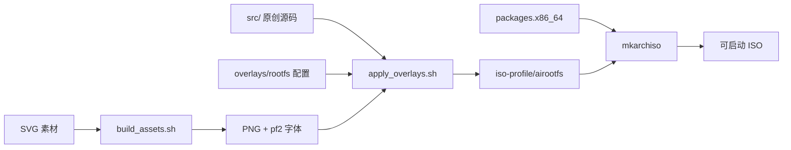

# 系统架构

本文描述 xuan OS 从构建期到运行期的分层结构与关键决策。

## 分层总览

xuan OS 自下而上分为四层：

1. **基础层（Arch Linux）**：Linux 内核、固件、systemd、pacman。
   滚动仓库保证内核与用户态软件始终接近上游最新版本。
2. **兼容层（Wine 生态）**：Wine 提供 Win32/Win64 API 实现，DXVK 把
   Direct3D 9/10/11 转译为 Vulkan，VKD3D 处理 Direct3D 12，
   Bottles 在其上提供隔离的前缀管理，Proton 面向游戏场景。
3. **桌面层（KDE Plasma 6）**：Plasma Workspace、KWin（Wayland）、
   SDDM。通过 skel 配置与系统级主题实现 Windows 11 风格交互。
4. **体验层（xuan OS 原创组件）**：`xuan-ctl`、`xuan-winrun`、欢迎中心。

## 构建期数据流



- `build_assets.sh` 只做确定性转换：SVG 光栅化、`grub-mkfont` 生成字体。
- `apply_overlays.sh` 用 `rsync -a` 叠加 overlay，再以 `install` 放置
  编译产物与 Calamares 配置，不删除 airootfs 中既有的 chroot 脚本。
- `mkarchiso` 读取 `profiledef.sh`，通过 pacstrap 按 `packages.x86_64`
  安装软件，在 chroot 内执行 `customize_airootfs.sh`，最后用 squashfs
  压缩并生成 UEFI/BIOS 混合引导镜像。

## 运行期关键机制

### 会话启动

```
固件 → GRUB(theme: xuanos) → Linux → systemd → SDDM(theme: xuanos)
      → Plasma(Wayland) → autostart: xuan-welcome
```

Live 环境通过 SDDM 自动登录固定 UID 1000 的 `xuan` 用户；
Calamares 的 `shellprocess` 模块在安装后移除自动登录与免密 sudo 配置。

### Windows 程序路径

双击 `.exe` 时，`mimeapps.list` 把 `application/x-dosexec` 指向
`xuan-winrun`，由其完成：

1. `realpath` 解析绝对路径，`winepath` 转换为 Windows 路径；
2. 按扩展名分派（`.msi` 走 `msiexec`，`.bat/.cmd` 走 `wine cmd`）；
3. 首次运行自动 `wineboot --init`，全过程写入日志。

systemd 的 `systemd-binfmt` 同时注册 Wine 处理器，命令行场景也可直接
`./app.exe`。

### 配置继承

所有桌面默认配置放在 `/etc/skel`，安装器创建的新用户首次登录即继承；
系统级默认值（sysctl、环境变量、输入法）放在 `/etc` 对应目录，
对所有用户生效。

## 可复现性约束

- 仅使用官方签名仓库，构建期 `pacman.conf` 不启用任何第三方源；
- `profiledef.sh` 支持 `SOURCE_DATE_EPOCH`，便于 CI 固定时间戳；
- 每次构建产出 `SHA256SUMS.txt`，测试套件对全部脚本做静态校验。
