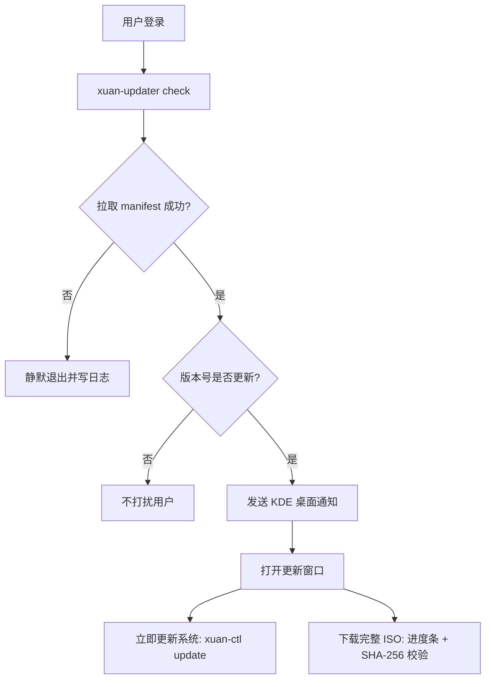

# OTA 在线更新机制

xuan OS 内置完整的"服务器发布 → 客户端检测 → 用户确认更新"闭环，
全部基于静态文件与开源工具，不依赖专有服务。

## 三个组成部分

| 部分 | 位置 | 职责 |
| --- | --- | --- |
| 更新站点 | `update-site/` | 托管 `index.html`、`manifest.json`、ISO 与校验和 |
| 客户端 | `src/xuan-updater/` | 开机检查、桌面通知、更新窗口、下载与校验 |
| 发布脚本 | `scripts/publish_release.sh` | 把新 ISO 登记到站点并刷新清单 |

## 每周发布流程

1. 构建新 ISO：`./build.sh`；
2. 编写本次更新说明（纯文本，每行一条）；
3. 发布到站点目录：
   ```bash
   scripts/publish_release.sh build/out/xuanos-<版本>-x86_64.iso <版本> notes.txt
   ```
   脚本会自动计算大小与 SHA-256、复制 ISO、把旧版本移入历史记录；
4. 部署 `update-site/` 到 EdgeOne Pages（Git 集成或 CLI），
   客户端下次开机即可看到新版本。

## 客户端工作流程



- 静默检查挂在 `/etc/xdg/autostart`，网络失败只写日志、不打断开机；
- 版本号按数字分段比较，避免字符串误判；
- ISO 下载到 `~/.local/share/xuanos/downloads/`，校验不通过会明确报错，
  防止安装损坏的镜像。

## 两种更新通道的区别

- **系统更新（推荐日常使用）**：通过 pacman 滚动升级已安装的软件包与内核，
  在线完成、增量下载，是真正的"点一下就更新"；
- **完整 ISO 镜像**：用于制作启动盘、新设备安装或离线重装，
  不能在运行中的系统上直接覆盖安装。

## 配置

更新地址在 `/etc/xuanos/updater.conf` 的 `MANIFEST_URL`，
站点域名确定后改这一处即可，无需重新打包镜像。
